# CanteenX System Architecture & Diagrams Specification

> [!IMPORTANT]
> **Source-of-Truth Compliance**: This document defines the genuine software architecture, data flows, entity relationships, and sequence interactions for **CanteenX - Smart Campus Food Service Platform**. All scam detection/Sentinel components from legacy references have been completely excluded.

---

## 1. System Architecture Diagram

```mermaid
flowchart TD
    subgraph USER_LAYER["User Access Layer (Responsive Multi-Device UI)"]
        A1["Student Portal (Mobile-First)"]
        A2["Faculty Cabin Portal"]
        A3["Kitchen Staff Kiosk / Scanner"]
        A4["Manager Operational Dashboard"]
        A5["College & Super Admin Console"]
    end

    subgraph PRESENTATION_LAYER["Frontend Application Layer"]
        B1["React 18 SPA + Vite"]
        B2["Tailwind CSS + Lucide Icons"]
        B3["Socket.IO Client Real-Time Listener"]
        B4["Recharts / Chart.js Data Visualizations"]
    end

    subgraph API_GATEWAY["Backend Core API Gateway (Node.js & Express)"]
        C1["JWT Authentication & RBAC Middleware"]
        C2["Order Engine & Token Generator"]
        C3["Inventory & Waste Tracker"]
        C4["Socket.IO Event Broadcaster"]
        C5["Razorpay Payment Handler"]
    end

    subgraph AI_LAYER["AI / ML Microservice (FastAPI & Python)"]
        D1["XGBoost Demand Forecaster"]
        D2["Queue & Wait Time Estimator"]
        D3["Predictive Inventory Alert Engine"]
        D4["Personalized Recommendation Engine"]
        D5["AI Operations Copilot (DB RAG Analytics)"]
    end

    subgraph DATABASE_LAYER["Persistence & Cache Layer"]
        E1[("PostgreSQL / SQLite Storage")]
        E2["Normalized Relational Schema (28 Tables)"]
    end

    subgraph EXTERNAL_SERVICES["External Integrations"]
        F1["Razorpay Payment Gateway"]
        F2["Firebase Cloud Messaging (FCM)"]
    end

    A1 & A2 & A3 & A4 & A5 --> B1
    B1 --> B2 & B3 & B4
    B1 -->|REST HTTP / HTTPS| C1
    B3 <-->|WebSocket bi-directional| C4
    C1 --> C2 & C3 & C5
    C2 & C3 & C5 --> E1
    C1 -->|FastAPI Proxy / Internal Call| D1 & D2 & D3 & D4 & D5
    D1 & D2 & D3 & D4 & D5 -->|Query Analytics & History| E1
    C5 <--> F1
    C4 -.-> F2
```

---

## 2. UML / Use Case Diagram

```mermaid
graph TD
    subgraph ACTORS["Platform Actors"]
        Student["Student"]
        Faculty["Faculty Member"]
        Staff["Canteen Staff"]
        Manager["Canteen Manager"]
        Admin["College Admin"]
        SuperAdmin["Super Admin"]
    end

    subgraph USE_CASES["CanteenX Core Use Cases"]
        UC1["Browse Menus & Real-Time Availability"]
        UC2["Check Queue & Estimated Wait Time"]
        UC3["Place Online Order (Pickup / Cabin Delivery)"]
        UC4["Select Capacity-Constrained Pickup Slot"]
        UC5["Process Digital Payment (Razorpay/Mock)"]
        UC6["Receive Digital Token & Live Order Tracking"]
        UC7["Scan & Validate QR Code Token"]
        UC8["Manage Kitchen Queue & Order States"]
        UC9["Update Food Item Stock & Preparation Time"]
        UC10["Log Food Waste & Waste Reason"]
        UC11["Manage Menu, Categories & Pricing"]
        UC12["Track Ingredients & Predictive Low-Stock"]
        UC13["Query AI Operations Copilot"]
        UC14["View Canteen Analytics & Sustainability Score"]
        UC15["Manage Campus Users & Announcements"]
        UC16["Manage Multi-College System Settings"]
    end

    Student --> UC1 & UC2 & UC3 & UC4 & UC5 & UC6
    Faculty --> UC1 & UC2 & UC3 & UC4 & UC5 & UC6
    Staff --> UC7 & UC8 & UC9 & UC10
    Manager --> UC9 & UC10 & UC11 & UC12 & UC13 & UC14
    Admin --> UC14 & UC15
    SuperAdmin --> UC16
```

---

## 3. Entity-Relationship (ER) Diagram

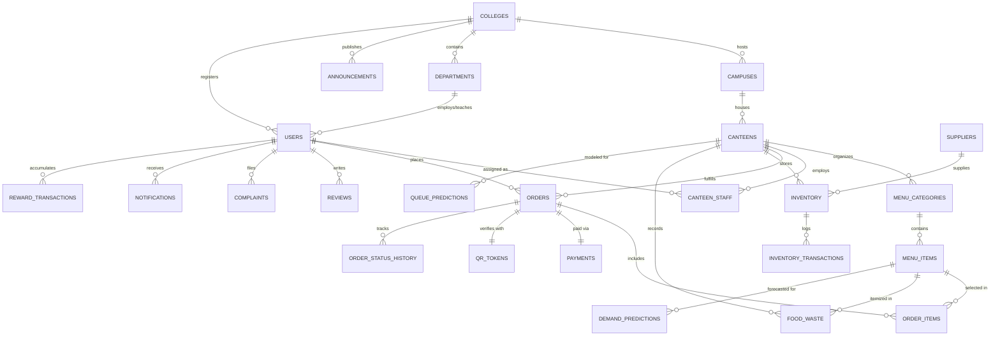

---

## 4. Data Flow Diagrams (DFD)

### DFD Level 0 (Context Diagram)

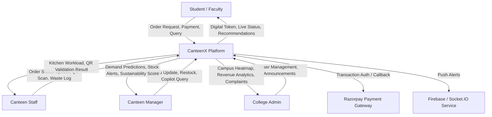

### DFD Level 1 (Decomposed Processes)

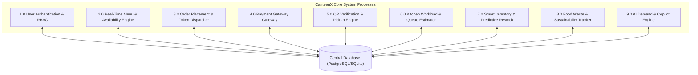

---

## 5. Component Diagram

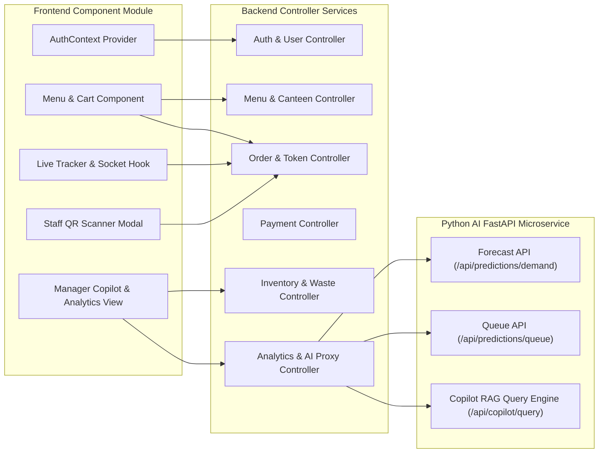

---

## 6. Sequence Diagrams

### Sequence Diagram 1: Student Login & Role Authentication

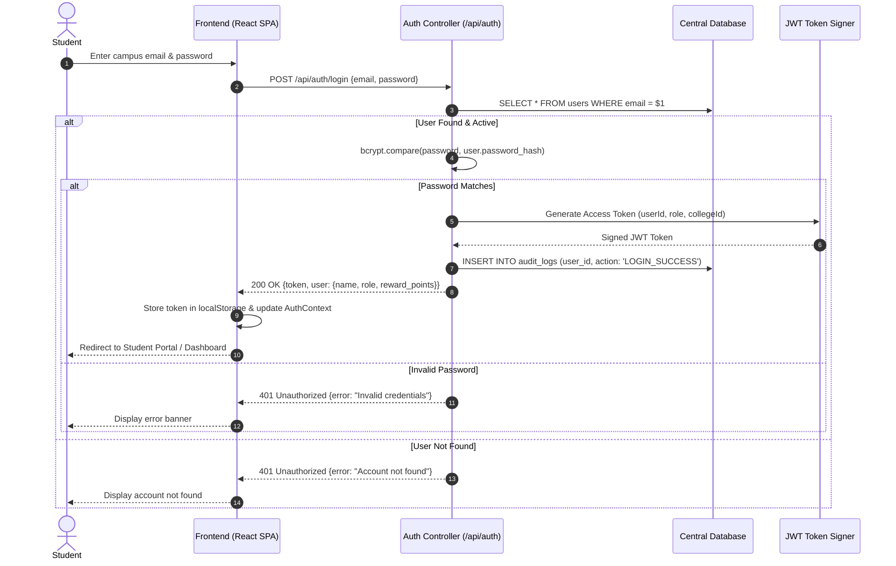

---

### Sequence Diagram 2: Food Ordering & Capacity Slot Allocation

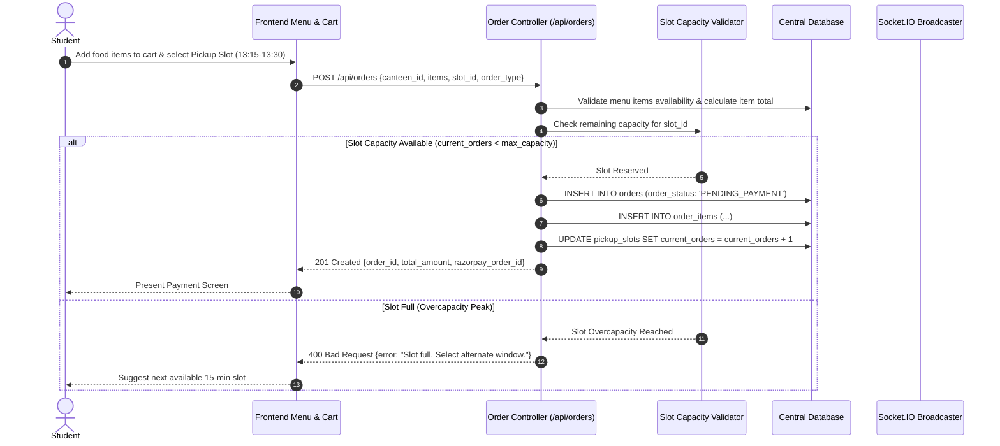

---

### Sequence Diagram 3: Digital Payment Processing (Razorpay / Mock)

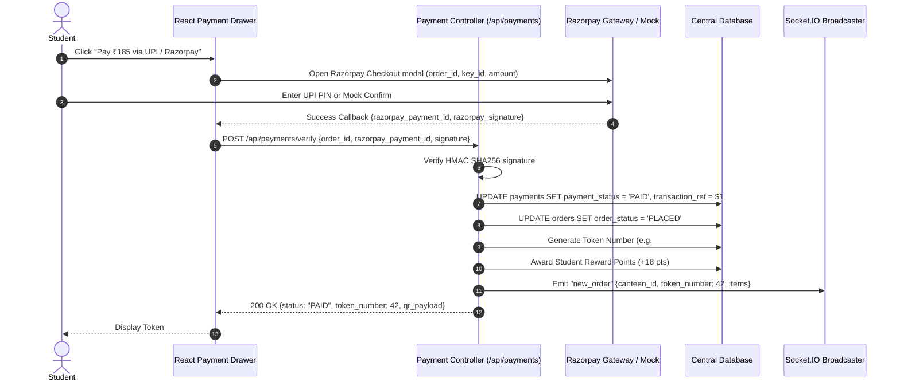

---

### Sequence Diagram 4: Staff QR Code Verification & Token Pickup

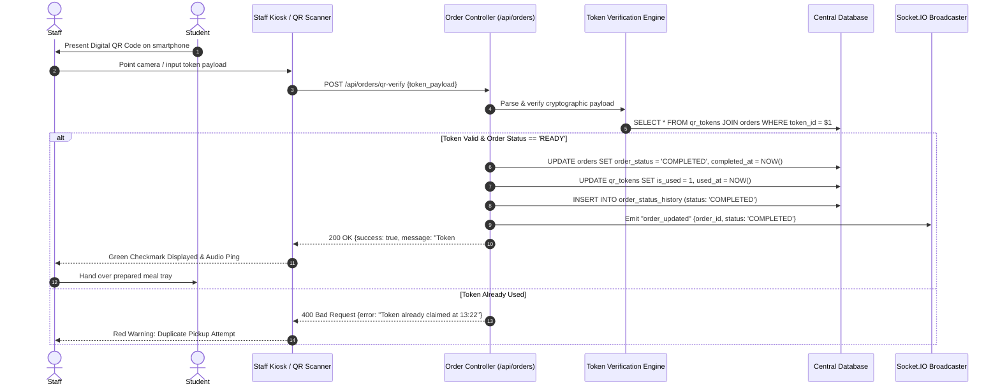

---

### Sequence Diagram 5: AI Demand Prediction & Preparation Planning

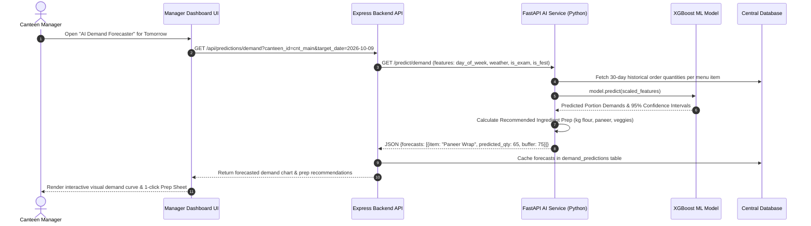

---

### Sequence Diagram 6: AI Queue & Wait Time Estimation

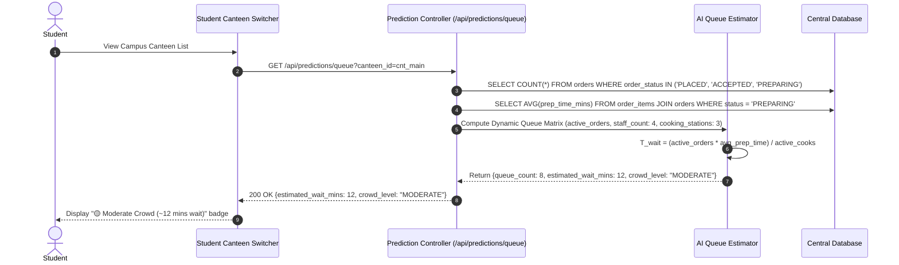

---

### Sequence Diagram 7: Predictive Inventory Alert & Automatic Restocking Trigger

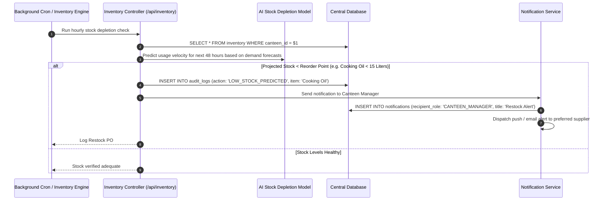

---

### Sequence Diagram 8: Faculty Cabin Delivery & Priority Dispatch

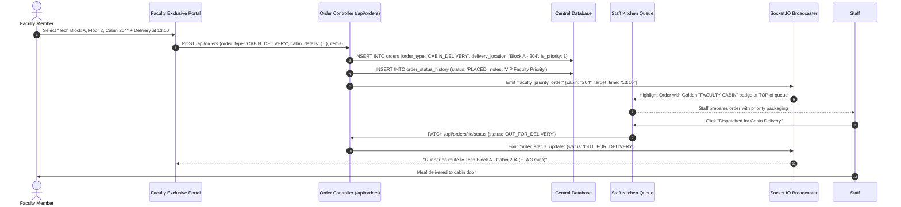
